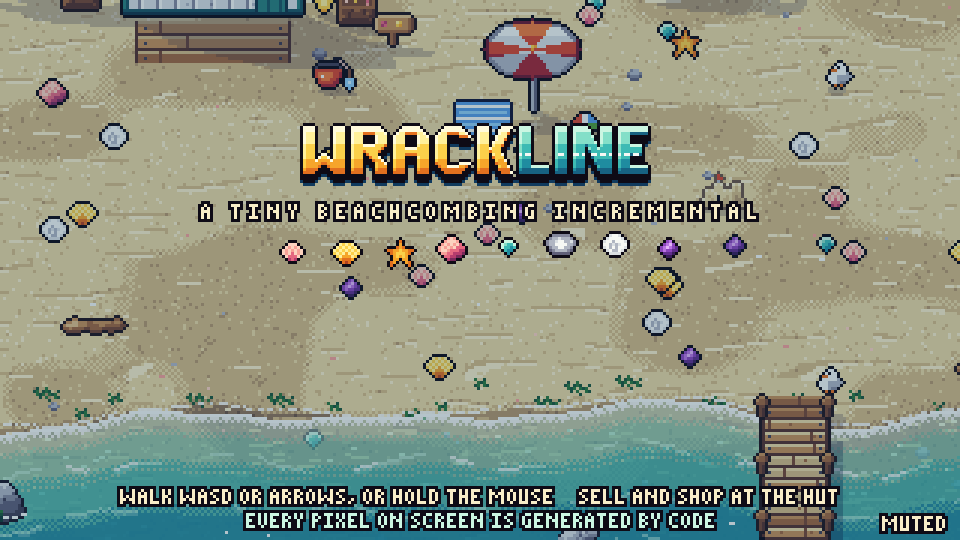
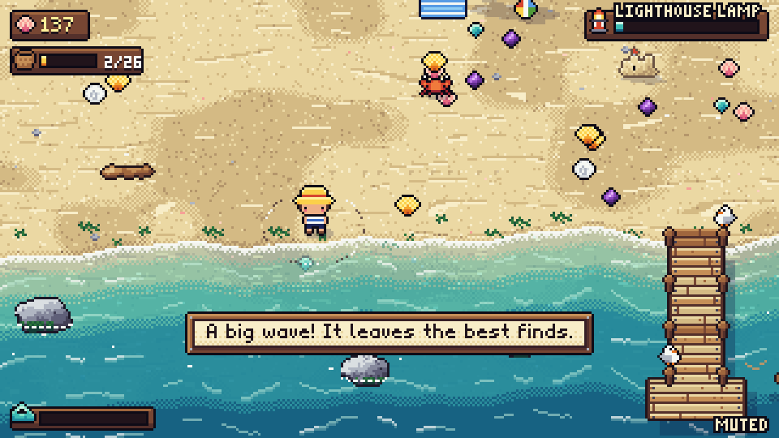
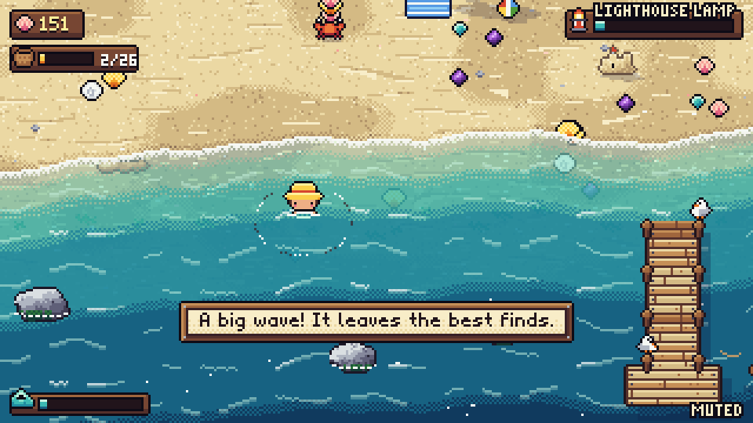
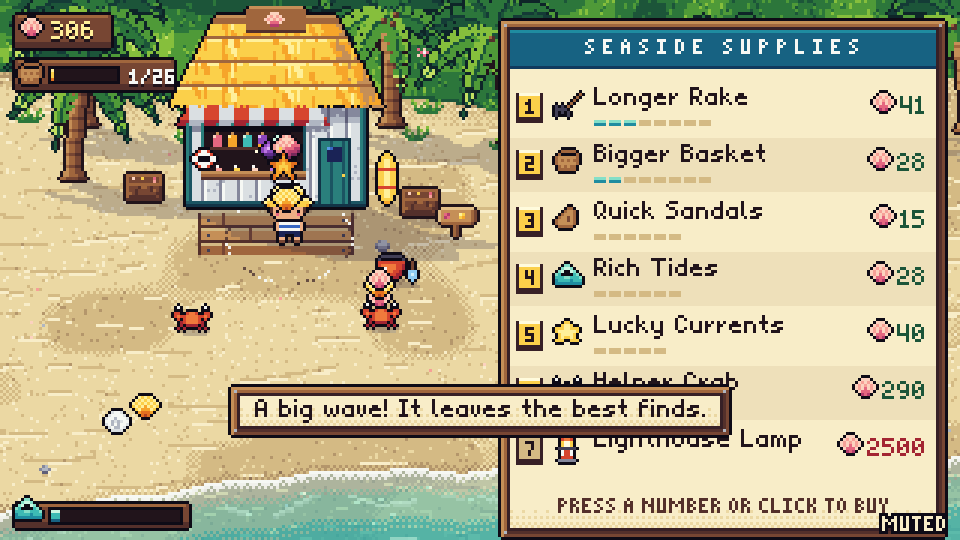
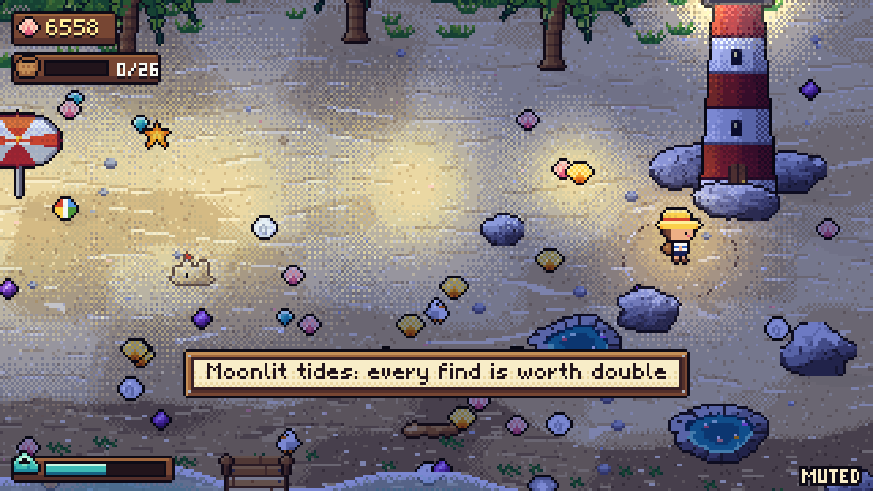
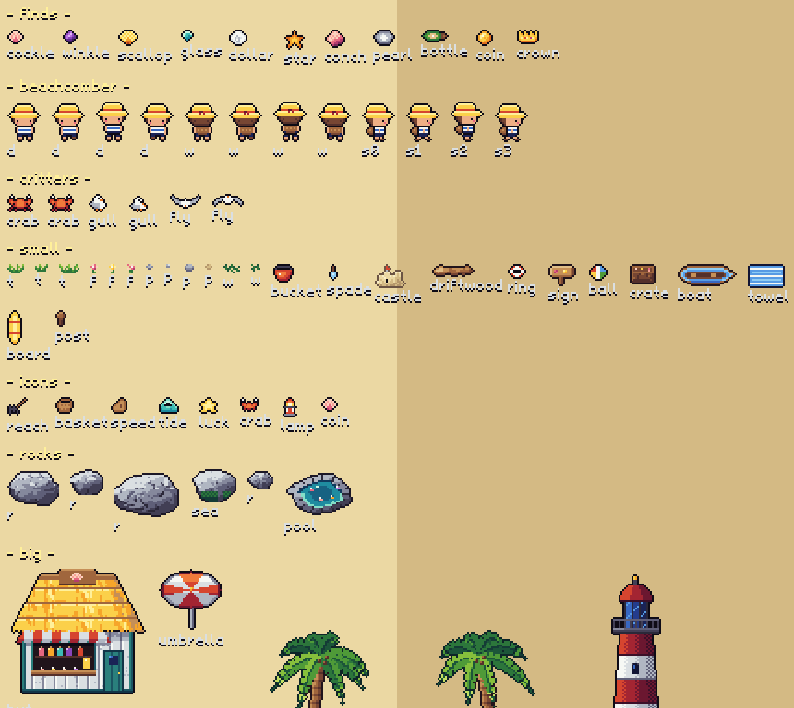
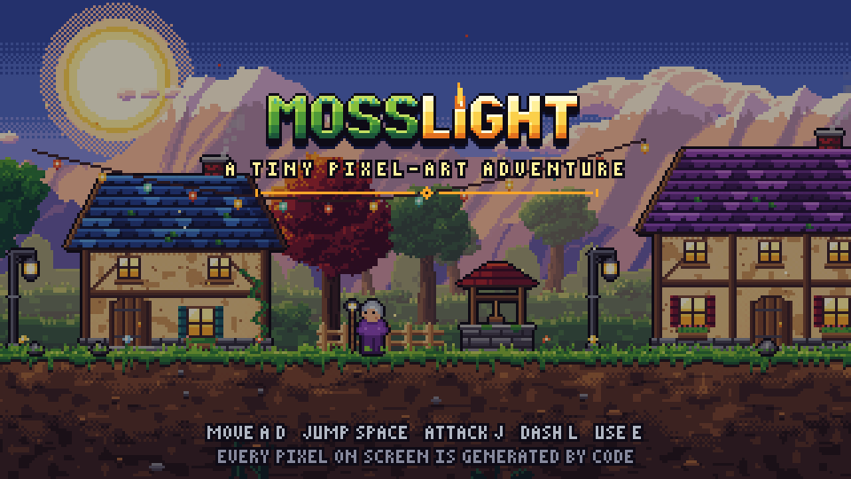
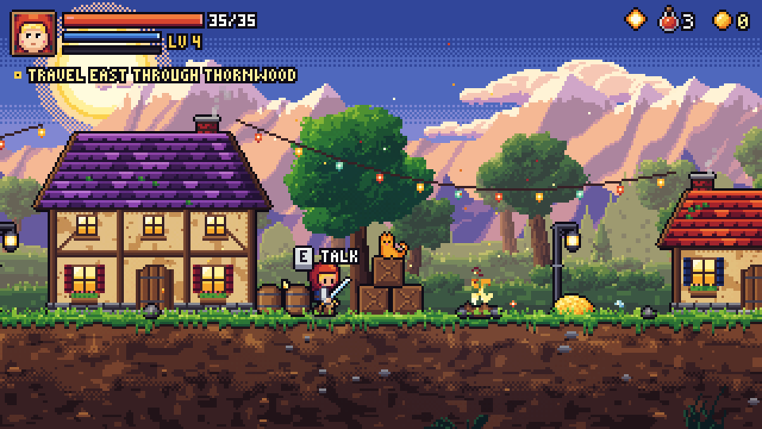
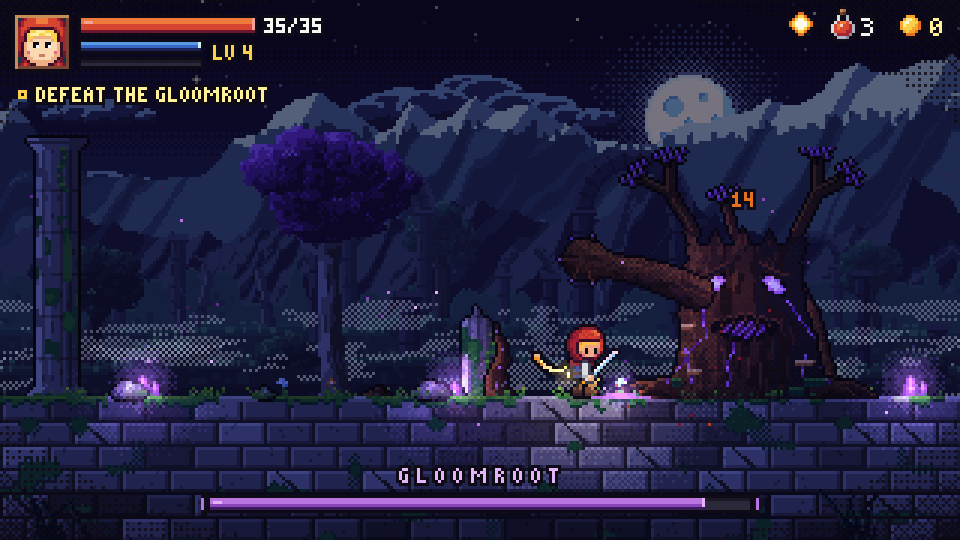
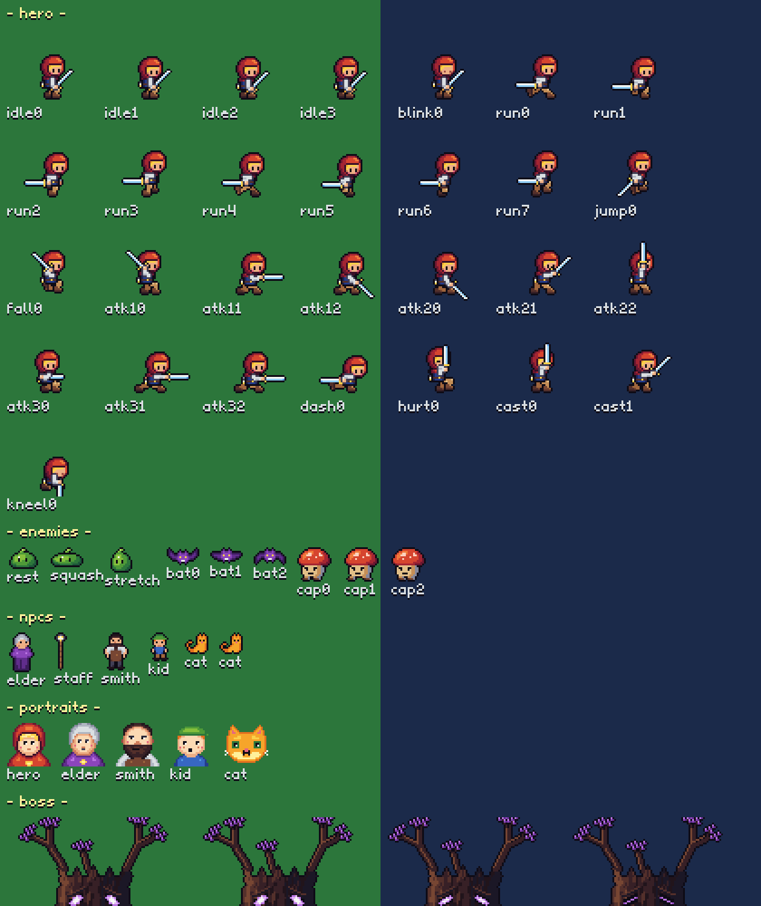

# Two pixel-art game demos

Two small, complete games that share one pixel-art toolkit:

- **Mosslight**: a side-scrolling action RPG (village, forest, ruins, boss).
- **Wrackline**: a top-down beachcombing incremental (gather, sell, upgrade, relight the lighthouse).

**There are no image or audio files in this repository.** Every sprite, tile, background,
font glyph, sound effect and music loop is generated by code when the page loads.

## Play

No install step is needed to play; the dev server has zero dependencies.

```bash
npm start
```

Then open <http://localhost:8080> for Mosslight or <http://localhost:8080/wrackline/> for Wrackline.
To get each game as one self-contained HTML file instead:

```bash
npm install
```

```bash
npm run build
```

That writes `dist/mosslight.html` (about 140 kB) and `dist/wrackline.html` (about 77 kB), which run straight from disk.

---

## Wrackline (top-down)

Walk the beach, pick up what the tide leaves, sell it at the hut, buy upgrades, and save up
for a new lamp for the lighthouse. A full run takes roughly five to ten minutes.



| | |
|---|---|
|  |  |
|  |  |

### Controls

| Action | Input |
|---|---|
| Walk | `W` `A` `S` `D` / arrows, or hold the mouse (or a finger) where you want to go |
| Gather | automatic inside the dotted ring |
| Sell and shop | stand on the deck in front of the hut; press `1`-`7` or click a row to buy |
| Pause, mute, fullscreen | `Esc`, `M`, `F` |

Progress is kept in the browser's local storage; `N` on the pause screen starts over.

### What is in it

- A 512 x 288 beach with a hut, pier, palms, tide pools, rocks and a lighthouse, drawn in a 3/4 top-down view.
- A living shoreline: small waves every few seconds and a big one every half minute. Each leaves a fresh line of finds and a band of wet sand that slowly dries.
- Eleven kinds of finds across four rarity tiers, from cockles to a sunken crown.
- Seven upgrades: reach, basket size, speed, richer tides, luck, up to four helper crabs, and the lamp.
- The afternoon warms toward sunset as you earn; night falls when the lamp is lit and the beam sweeps the sand.

### How the top-down art is made

| Technique | Where |
|---|---|
| Finds, critters, clutter and icons written as ASCII grids, auto-outlined | `wrackline/src/art.js` |
| Beachcomber built from hat, face, body and leg parts: 3 facings x 4 walk frames | `wrackline/src/art.js` |
| Procedural painters for the hut, lighthouse, palms (three wind frames), rocks, pier | `wrackline/src/art.js` |
| Sand painted per pixel with ripples and grain, in dry and wet versions | `wrackline/src/beach.js` |
| Sea drawn in one-pixel columns from textures indexed by depth below a moving waterline | `wrackline/src/beach.js`, `wrackline/src/game.js` |
| Ground shadows cast from each sprite's own silhouette | `wrackline/src/beach.js` |
| Tide, gathering, crabs, gulls, shop, day-to-night lighting | `wrackline/src/game.js` |

Sprite sheet viewer: `/gallery.html?mods=../wrackline/src/art.js`



---

## Mosslight (side-scroller)

You are Wren, the last lamplighter of Lanternwick: cross Thornwood as dusk falls, beat the
Gloomroot, and relight the Ember.



| | |
|---|---|
|  |  |
|  |  |

### Controls

| Action | Keyboard | Gamepad |
|---|---|---|
| Move | `A` `D` / arrows | stick / d-pad |
| Jump (hold for height) | `Space` / `W` / `Z` | A |
| Sword combo (three hits) | `J` / `X` | X |
| Dash (brief invulnerability) | `L` / `C` / `Shift` | B |
| Ember Spark, once found | `K` / `V` | Y |
| Talk / use / rest | `E` / `Enter` | LB |
| Drink tonic | `Q` / `H` | RB |
| Pause, mute, fullscreen | `Esc`, `M`, `F` | Start |

Touch devices get on-screen buttons.

### What is in it

- One continuous level, about twelve screens wide: village, forest, ruins, boss arena.
- Time of day follows your progress: golden hour, dusk, night, and a sunrise when you win.
- Three-hit sword combo, dash, a fire spell, tonics, XP and levels, coins, chests, campfire checkpoints.
- Four villagers with portraits and dialogue, three enemy types, a two-phase boss.
- Dynamic lighting, reflective water, seven parallax layers (five behind, two in front), drifting leaves, fireflies.

### How the side-view art is made

| Technique | Where |
|---|---|
| Hand-drawn sprites written as ASCII grids, auto-outlined | `src/gfx/art-props.js`, `src/gfx/art-chars.js` |
| Hero: hand-drawn head, torso and sword posed by a two-bone IK rig, 29 frames | `src/gfx/art-hero.js` |
| Procedural painters for trees, cottages, pillars, the boss | `src/gfx/art-trees.js`, `src/gfx/art-props.js` |
| Terrain skinned per pixel from the collision grid, so nothing tiles visibly | `src/gfx/terrain.js` |
| Backdrops painted once in abstract colour slots, then re-coloured per mood | `src/gfx/art-bg.js` |
| Two bitmap fonts and the title logo | `src/gfx/font.js`, `src/gfx/ui.js` |

Sprite sheet viewer: `/gallery.html`



Handy URL switches: `?start=forest|pond|ruins|gate|boss|shrine` jumps ahead, `?god` makes you
unkillable, `?mute` starts silent.

---

## Shared toolkit

| Piece | Where |
|---|---|
| One 75-colour palette of hue-shifted ramps (63 used by Mosslight, 12 sand and sea colours added for Wrackline) | `src/gfx/palette.js` |
| Indexed bitmaps, ASCII sprite parser, outlines, noise, ordered dither | `src/gfx/pixel.js` |
| Two bitmap fonts | `src/gfx/font.js` |
| Banded, ordered-dither light pools multiplied over the scene | `src/gfx/light.js` |
| Chiptune synth for effects and music loops | `src/audio.js` |

## Layout

```
index.html        Mosslight page
wrackline/        Wrackline page, styles and source
gallery.html      sprite sheet viewer
src/gfx/          shared pixel toolkit and Mosslight's art generators
src/game/         Mosslight's level, entities, rendering, HUD, game state
src/audio.js      synth
tools/serve.mjs   static server
tools/build.mjs   single-file bundler (esbuild)
```
