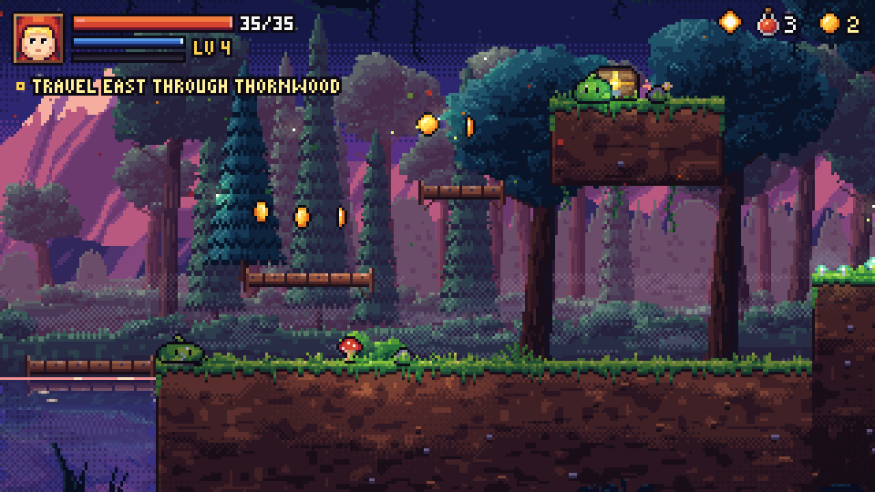
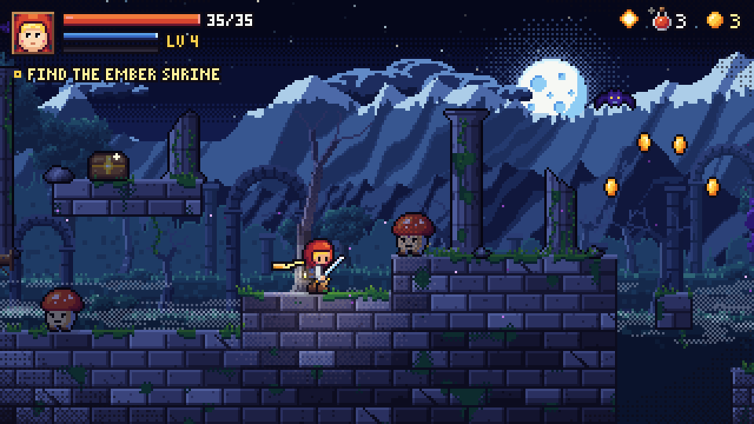

# Mosslight

A tiny side-scrolling pixel-art action RPG. You are Wren, the last lamplighter of Lanternwick:
cross Thornwood as dusk falls, beat the Gloomroot, and relight the Ember.

**There are no image or audio files in this repository.** Every sprite, tile, background,
font glyph, sound effect and music loop is generated by the code in `src/` when the page loads.


| | |
|---|---|
|  |  |
|  |  |

## Play

No install step is needed to play; the dev server has zero dependencies.

```bash
npm start
```

Then open <http://localhost:8080>. To get one self-contained HTML file instead:

```bash
npm install
```

```bash
npm run build
```

That writes `dist/mosslight.html` (about 140 kB), which runs straight from disk.

### Controls

| Action | Keyboard | Gamepad |
|---|---|---|
| Move | `A` `D` / arrows | stick / d-pad |
| Jump (hold for height) | `Space` / `W` / `Z` | A |
| Sword combo (three hits) | `J` / `X` | X |
| Dash (brief invulnerability) | `L` / `C` / `Shift` | B |
| Ember Spark, once found | `K` / `V` | Y |
| Talk / use / rest | `E` / `Enter` | LB |
| Drink tonic | `Q` / `H` | RB |
| Pause, mute | `Esc`, `M` | Start |

Touch devices get on-screen buttons.

## What is in the demo

- One continuous level, about twelve screens wide: village, forest, ruins, boss arena.
- Time of day follows your progress: golden hour, dusk, night, and a sunrise when you win.
- Three-hit sword combo, dash, a fire spell, tonics, XP and levels, coins, chests, campfire checkpoints.
- Four villagers with portraits and dialogue, three enemy types, a two-phase boss.
- Dynamic lighting, reflective water, parallax with six depth layers, weather particles, fireflies.

## How the art is made

| Technique | Where |
|---|---|
| One 60-colour palette of hue-shifted ramps; everything indexes into it | `src/gfx/palette.js` |
| Hand-drawn sprites written as ASCII grids, auto-outlined | `src/gfx/art-props.js`, `src/gfx/art-chars.js` |
| Hero: hand-drawn head, torso and sword posed by a two-bone IK rig, 33 frames | `src/gfx/art-hero.js` |
| Procedural painters for trees, cottages, pillars, the boss | `src/gfx/art-trees.js`, `src/gfx/art-props.js` |
| Terrain skinned per pixel from the collision grid, so nothing tiles visibly | `src/gfx/terrain.js` |
| Backdrops painted once in abstract colour slots, then re-coloured per mood | `src/gfx/art-bg.js` |
| Banded, ordered-dither light pools multiplied over the playfield | `src/gfx/light.js` |
| Two bitmap fonts and the title logo | `src/gfx/font.js`, `src/gfx/ui.js` |
| Chiptune synth for effects and four music loops | `src/audio.js` |

Open `/gallery.html` while the server is running to browse the sprite sheets.


## Layout

```
index.html        game page
gallery.html      sprite sheet viewer
src/gfx/          pixel toolkit and all art generators
src/game/         level, entities, rendering, HUD, game state
src/audio.js      synth
tools/serve.mjs   static server
tools/build.mjs   single-file bundler (esbuild)
```

Handy URL switches: `?start=forest|pond|ruins|gate|boss|shrine` jumps ahead, `?god` makes you
unkillable, `?mute` starts silent.
